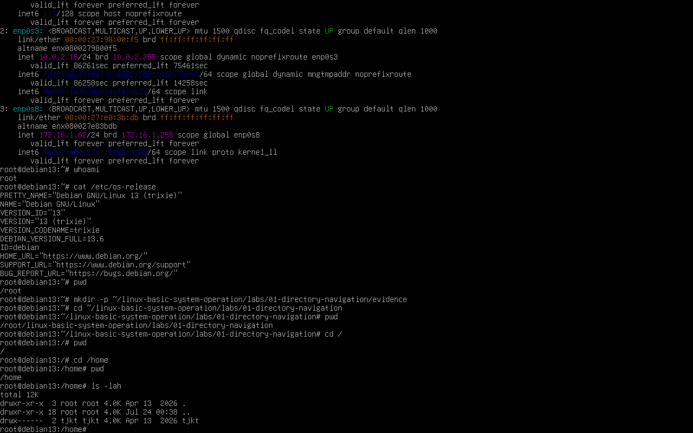
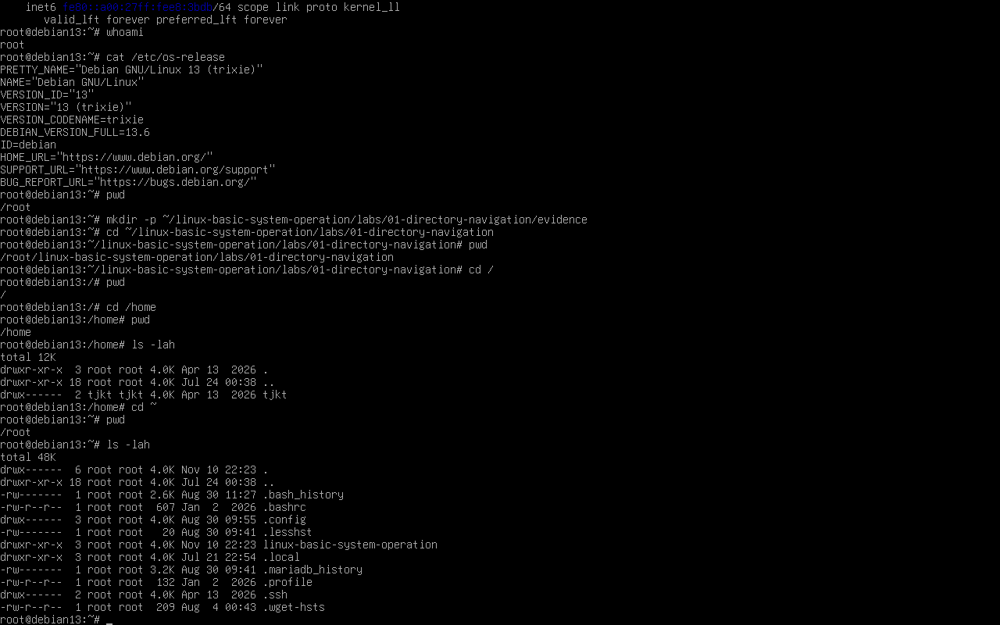

# Lab 01: Navigasi Direktori

## Tujuan

Berlatih mengetahui lokasi saat ini, berpindah direktori, dan melihat isi direktori di Debian GNU/Linux 13 menggunakan Bash.

## Alat yang Digunakan

- Komputer atau mesin virtual Debian GNU/Linux 13
- Terminal Bash; screenshot hasil praktik yang dilampirkan direkam sebagai `root`.

## Daftar Perintah

| Perintah | Fungsi |
| --- | --- |
| `pwd` | Menampilkan path direktori kerja saat ini. |
| `ls` | Menampilkan nama file dan direktori pada lokasi saat ini. |
| `ls -lah` | Menampilkan isi termasuk file tersembunyi, beserta detail dan ukuran yang mudah dibaca. |
| `cd` | Berpindah ke direktori lain; `cd` tanpa argumen kembali ke home directory. |
| `cd ..` | Berpindah ke direktori induk. |
| `cd /` | Berpindah ke direktori root. |

## Langkah Praktik

1. Buka terminal Bash, periksa nama pengguna dan versi Debian, lalu lokasi awal:

   ```bash
   whoami
   cat /etc/os-release
   pwd
   ```

2. Lihat isi direktori saat ini:

   ```bash
   ls
   ls -lah
   ```

3. Berpindah ke home directory, lalu periksa lokasinya:

   ```bash
   cd
   pwd
   ```

4. Masuk ke direktori induk dan lihat isinya:

   ```bash
   cd ..
   pwd
   ls
   ```

5. Pindah ke root, lalu kembali ke home:

   ```bash
   cd /
   pwd
   cd ~
   pwd
   ```

## Hasil yang Diharapkan

- `pwd` menampilkan path sesuai lokasi yang sedang ditempati. Path awal dan nama pengguna dapat berbeda.
- `ls` menampilkan isi direktori yang dapat diakses. Isi setiap komputer tidak harus sama.
- `cd`, `cd ..`, `cd /`, dan `cd ~` mengubah lokasi kerja sesuai tujuan.

## Kesimpulan

`pwd` membantu memastikan lokasi, `ls` membantu memeriksa isi, sedangkan `cd` digunakan untuk berpindah. Biasakan memeriksa path sebelum melakukan operasi file.

## Hasil Praktik dan Bukti

Pada bukti terminal, `cat /etc/os-release` mengidentifikasi Debian GNU/Linux 13 (trixie), sedangkan `whoami` menampilkan `root`. Perintah `whoami` menunjukkan nama akun efektif yang sedang menjalankan perintah. Karena `root` memiliki hak administratif penuh, gunakan akun biasa untuk latihan sehari-hari dan berhati-hatilah saat menjalankan perintah yang mengubah sistem.

Perintah `pwd` menunjukkan direktori aktif. `cd /` berpindah ke root direktori (`/`), `cd /home` berpindah ke `/home`, dan `cd ~` kembali ke home pengguna, yaitu `/root` pada bukti ini. `ls -lah` menampilkan daftar terperinci, termasuk file tersembunyi, dengan ukuran yang mudah dibaca.

### Informasi Sistem



### Navigasi Direktori



## Screenshot yang Perlu Diambil

Ambil screenshot terminal setelah menjalankan rangkaian `pwd`, `ls -lah`, dan perpindahan ke root lalu kembali ke home. Pastikan perintah dan keluarannya terlihat, kemudian simpan screenshot asli di folder `evidence/` ini.