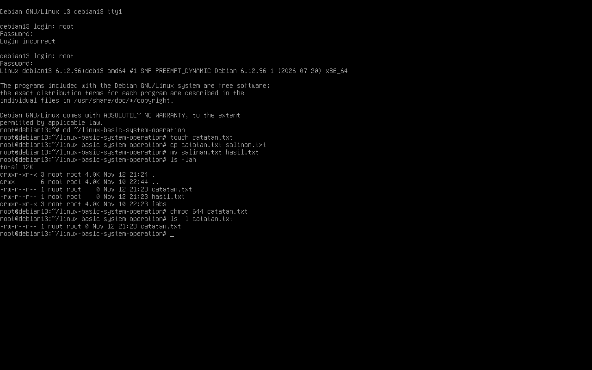

# Lab 02: Manajemen File dan Direktori

## Tujuan

Berlatih membuat, menyalin, memindahkan, dan menghapus file serta direktori dengan aman pada folder latihan.

## Alat yang Digunakan

- Komputer atau mesin virtual Debian GNU/Linux 13
- Terminal Bash; screenshot hasil praktik yang dilampirkan direkam sebagai `root`.

## Daftar Perintah

| Perintah | Fungsi |
| --- | --- |
| `mkdir -p` | Membuat direktori beserta direktori induk yang belum ada. |
| `touch` | Membuat file kosong jika belum ada. |
| `cp` | Menyalin file. |
| `cp -r` | Menyalin direktori beserta isinya. |
| `mv` | Memindahkan atau mengganti nama file/direktori. |
| `rm` | Menghapus file; tindakan ini tidak memindahkan file ke Trash. |
| `rm -r` | Menghapus direktori beserta isinya; gunakan hanya pada path yang sudah diperiksa. |
| `rmdir` | Menghapus direktori kosong. |
| `ls` | Memeriksa file dan direktori yang ada. |
| `chmod 644` | Mengatur permission file menjadi baca/tulis untuk pemilik dan baca saja untuk grup serta pengguna lain. |

## Langkah Praktik

Semua kegiatan berikut dibatasi pada `~/praktik-linux/file-management/`. Periksa kembali path sebelum menjalankan perintah penghapusan.

1. Buat folder kerja dan masuk ke dalamnya:

   ```bash
   mkdir -p ~/praktik-linux/file-management
   cd ~/praktik-linux/file-management
   pwd
   ```

2. Buat file, lalu buat salinannya:

   ```bash
   touch catatan.txt
   cp catatan.txt salinan.txt
   ls -l
   ```

3. Buat direktori dan salin file ke dalamnya:

   ```bash
   mkdir arsip
   cp catatan.txt arsip/
   ls -l arsip
   ```

4. Pindahkan salinan ke direktori arsip, lalu ganti namanya:

   ```bash
   mv salinan.txt arsip/
   mv arsip/salinan.txt arsip/catatan-lama.txt
   ls -l arsip
   ```

5. Hapus file latihan, kemudian hapus direktori yang sudah kosong:

   ```bash
   rm catatan.txt
   rm arsip/catatan.txt arsip/catatan-lama.txt
   rmdir arsip
   ls -la
   ```

6. (Opsional) Latih penghapusan direktori berisi hanya jika Anda yakin path-nya benar:

   ```bash
   mkdir -p ~/praktik-linux/file-management/contoh-hapus
   touch ~/praktik-linux/file-management/contoh-hapus/file-latihan.txt
   rm -r ~/praktik-linux/file-management/contoh-hapus
   ```

## Hasil yang Diharapkan

- File dan direktori latihan muncul setelah dibuat.
- File salinan memiliki nama dan lokasi yang dituju.
- Perintah `mv` memindahkan atau mengganti nama file tanpa membuat salinan tambahan.
- Setelah penghapusan, `ls -la` tidak lagi menampilkan item latihan yang dihapus. Folder induk `~/praktik-linux/file-management/` tetap ada.

## Kesimpulan

`mkdir`, `touch`, `cp`, `mv`, `rm`, dan `rmdir` mendukung operasi file sehari-hari. Perintah penghapusan dapat langsung menghilangkan data, jadi pastikan lokasi dengan `pwd` dan nama target dengan `ls` terlebih dahulu.

## Hasil Praktik dan Bukti

Screenshot berikut menunjukkan sesi Debian GNU/Linux 13 yang dijalankan sebagai `root`. `touch catatan.txt` membuat file, `cp catatan.txt salinan.txt` membuat salinannya, lalu `mv salinan.txt hasil.txt` memindahkan sekaligus mengganti nama salinan. Perintah `chmod 644 catatan.txt` mengatur permission file, yang kemudian diperiksa dengan `ls -l catatan.txt`.

Hasil `-rw-r--r--` berarti karakter pertama `-` menandakan file biasa. Tiga karakter berikutnya (`rw-`) memberi pemilik hak baca dan tulis; `r--` berikutnya memberi grup hak baca saja; dan `r--` terakhir memberi pengguna lain hak baca saja. Tidak ada hak eksekusi pada file tersebut.



## Screenshot yang Perlu Diambil

Ambil screenshot yang menunjukkan file setelah dibuat/disalin, hasil pemindahan atau penggantian nama, dan isi folder setelah pembersihan. Simpan screenshot asli di folder `evidence/` ini.